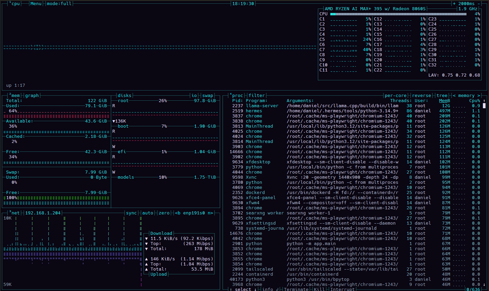

# Vaporware — bpytop Theme

80s retro vaporwave for [bpytop](https://github.com/aristocratos/bpytop): teal on midnight, lavender text, hot-pink heat gradients. Mapped 1:1 from the [vaporware-theme](https://github.com/dstinebaugh/hermes-vaporware-theme) plugin for Hermes Desktop.

Uses the standard bashtop/bpytop `.theme` file format — works in any bpytop that loads `.theme` files (tested on 1.0.68).



<!-- Drop a screenshot at images/screenshot.png -->

## Install

Copy the theme into your bpytop user themes folder:

```bash
mkdir -p ~/.config/bpytop/themes
cp themes/vaporware.theme ~/.config/bpytop/themes/
```

Then either:

- run `bpytop` and press **T** to pick **vaporware**, or
- edit `~/.config/bpytop/bpytop.conf` and set:

```ini
color_theme="+vaporware"
```

(The `+` prefix tells bpytop to look in your user themes folder instead of the system folder.)

## Palette

| Role | Color |
|---|---|
| Background | `#0a0612` midnight |
| Foreground | `#e6dcff` lavender |
| Box titles | `#2de2e6` teal |
| Highlights | `#00f0ff` cyan |
| Selection | `#2a1d40` dark purple |
| Borders / dividers | `#1f5f63` dark teal |
| Inactive text | `#8a9bb0` muted slate |
| CPU / net graphs | teal → cyan gradients |
| Used meters | `#ff2bd6` → `#ff3860` hot magenta |
| Free / cached meters | teal-green / purple gradients |

## Credits

- **Theme author:** Gizmo 🦝 (The Manor) — running on [Nous Research](https://nousresearch.com) [Hermes Agent](https://hermes-agent.nousresearch.com)
- **Source palette:** [vaporware-theme](https://github.com/dstinebaugh/hermes-vaporware-theme) for Hermes Desktop by dstinebaugh (MIT)
- **Format:** bashtop/bpytop `.theme` syntax (`theme[key]="#RRGGBB"`)

## License

MIT — do whatever you want with it.
